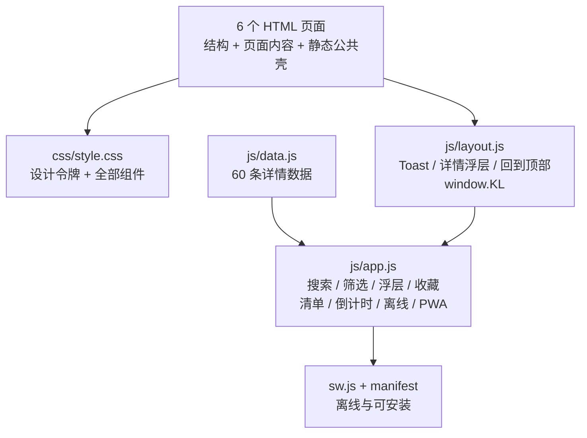

# 赣鄱四日 · 龙南 南昌 景德镇

> 2026 年 11 月 21–24 日，4 天 3 晚、三段高铁的赣鄱行程手册：**龙南老城 → 南昌滕王阁与万寿宫 → 景德镇一日往返**。
> 纯静态多页站点 + PWA 离线，手机打开即用，可「添加到主屏幕」当 App。

- 行程日期：2026.11.21 – 11.24
- 交通：广州东 → 龙南东（G3074）→ 南昌西（G2724）→ 广州南（G253）
- 住宿：龙南 1 晚（待定）+ 南昌万寿宫花间阁·泊时 2 晚（11.22、11.23）
- 结构沿用同目录的 `kaili-travel`，内容、配色与配图全部按南昌行程重做

---

## 一、项目定位与主要功能

### 定位

一份**给同行者看的私人行程手册**，把「怎么走、拍什么、吃什么、带什么、出问题怎么办」收进一个可离线访问的站点。不是 OTA，没有后端，所有内容以静态文件和本地数据内置在仓库里。

### 功能清单

| 模块 | 页面 | 能力 |
| --- | --- | --- |
| 首页 | `index.html` | 出发倒计时、天气/车次/天黑时间提示条、三城横滑卡片、四日路线、拍照机位、必吃、6 篇游记、紧急备案入口 |
| 打卡 | `explore.html` | 52 张内容卡 + 1 张美食入口（共 53 张）（机位 / 景点 / 美食 / 住宿 / 周边）分类筛选；**18 个具体机位**（按楼栋/楼层找，附小红书原文链接）；**雕塑瓷厂 9 站逛店路线**（步行约 4 小时）；避坑提醒；**出片指南**（光线、姿势、穿搭、器材）；文化速读 |
| 行程 | `trip.html` | Day 1–4 时间轴，含三段高铁车次与时刻、逐站贴士；**餐饮按天排入时间轴**（菜名可点开详情）；**雕塑瓷厂 9 站逛店路线**（4 小时）；**景德镇周末备选**（周六雕塑 + 陶溪川市集、周日三宝村；本次不去市集）；**只有两天怎么走**参考路线；**紧急备案** 9 条 |
| 打包 | `pack.html` | 8 组、49 条清单，可勾选并持久保存 |
| 我的 | `me.html` | 行程卡与倒计时、工具箱（收藏 / 打包进度 / 离线 / 安装）、快捷入口、收藏列表 |
| 美食 | `food.html` | 40 道三城美食（含景德镇 11 家店），5 个分组，可搜索；无独立 Tab，归到「打卡」下 |

### 通用交互

- **全站搜索**：首页 / 打卡 / 美食页顶部搜索框，160ms 防抖，匹配卡片文本与 `data-keywords`；整组结果为空时连分组标题一起隐藏。
- **热词 + 跨页深链**：`?kw=滕王阁` 形式跳转，落页自动筛选。
- **详情浮层**：任意卡片弹出，含插画头图、价格、正文要点、收藏；支持 `#/key` 深链、返回键 / Esc 关闭、焦点锁定。
- **收藏与打包进度**：localStorage 持久化，「我的」页与详情浮层双向同步。
- **PWA**：SW 预缓存 + 手动「离线行程」，断网可完整浏览；支持安装到主屏幕。
- **倒计时**：以 2026-11-21 为出发日，覆盖「距出发 / 明天 / 今天 / 行程中 / 已结束」五态。

### 明确的非目标

- **没有后端、账号、数据库**，状态只存在本机 `localStorage`。
- **不代订**：详情底部「立即预订」只提示到景区官方渠道购买，未接支付或订单。
- **天气是静态文案**，不请求任何天气/票务 API；车次与时刻来自行程本身，出行前需自行复核。
- **门票、价格、开放时间均为参考值**，页面内多处标注「以景区公告为准」——攻略会过期，别当合同看。

---

## 二、技术栈

**零框架、零依赖、零构建。**

| 层 | 选型 | 说明 |
| --- | --- | --- |
| 结构 | 原生 HTML5，6 个独立页面 | 多页架构，无 SPA 路由 |
| 样式 | 原生 CSS 单文件（`css/style.css`，约 800 行） | CSS 自定义属性做设计令牌，无预处理器 |
| 脚本 | 原生 JavaScript（ES5 语法，IIFE） | 三个 `<script defer>`，无打包器 |
| 数据 | `window.KL_DETAILS`（`js/data.js`） | 92 条详情，手写对象字面量 |
| 图标 | 内联 SVG `<symbol>` 雪碧图 | 58 个 24×24 线性图标；详情头图另用 JS 拼的手绘 SVG |
| 图片 | WebP，`-400` / `-800` 两档 | `` + `sizes` + 显式宽高 |
| 字体 | 自托管 Noto Serif SC 可变字体子集 | 仅标题；332 个汉字，约 188KB |
| 离线 | 手写 Service Worker + Manifest | stale-while-revalidate |
| 工具 | Python 3（仅开发期） | `build-shell.py` 生成公共壳；`subset-font.py` 字体子集化 |
| 部署 | Render Static Site | `render.yaml` 声明缓存头与 rewrite |

> 运行站点本身不需要安装任何东西；只有改标题字体时需要 `fonttools` + `brotli`。

---

## 三、技术架构

### 3.1 分层



### 3.2 三个关键决策

**① 公共壳写进 HTML，不用 JS 注入**
顶栏、底部 Tab、图标雪碧图由 `tools/build-shell.py` 写进 6 个页面的 `<!-- shell:xxx -->` 区块。`layout.js` 是 `defer` 脚本，慢网下会出现「有内容、没顶栏」再补齐的跳动；写进 HTML 后首帧就完整。脚本幂等，`--check` 只校验。

**② 内容集中在 `data.js`，卡片只写 `data-detail`**
页面只保留标题、摘要、缩略图；正文、价格、贴士放在 `KL_DETAILS[key]`，点击时渲染进同一个浮层。92 条内容只维护一处。

**③ 单入口 `app.js`，按元素存在性守卫**
同一份脚本被 6 页加载，每段逻辑都以 `if (!el) return` 开头；新增页面不需要拆包。

### 3.3 加载顺序

```html
<style>html{background:#FAF7F0}</style>          <!-- 首帧底色，防白闪 -->
<link rel="preload" as="font" ... crossorigin>  <!-- 标题字体 -->
<link rel="stylesheet" href="css/style.css">
<link rel="preload" as="image" ... fetchpriority="high">  <!-- 仅首页 -->
<script src="js/data.js" defer></script>
<script src="js/layout.js" defer></script>
<script src="js/app.js" defer></script>
```

`data → layout → app` 是硬顺序：`layout.js` 注入的浮层引用 `#i-close` 等图标，`app.js` 依赖 `window.KL` 与 `window.KL_DETAILS`。

---

## 四、目录与模块职责

```
nanchang-travel/
├── index.html              首页：倒计时、三城、四日路线、机位、必吃、游记
├── explore.html            打卡：分类卡片墙 + 避坑 + 出片指南（#photoGuide）+ 文化
├── trip.html               行程：Day 1–4 时间轴 + 紧急备案（#planB）
├── pack.html               打包：8 组 49 条，条目带 data-pack
├── me.html                 我的：行程卡、工具箱、快捷入口、收藏列表
├── food.html               美食：40 道，5 组（Tab 归属 explore）
│
├── css/style.css           设计令牌、布局、组件、断点、新组件（guide/plan/train）
├── js/
│   ├── data.js             92 条详情（内容层）
│   ├── layout.js           运行时元素 + window.KL（壳层）
│   └── app.js              页面行为（逻辑层）
├── sw.js                   预缓存、SWR、离线兜底
├── manifest.webmanifest    PWA 清单
├── assets/
│   ├── fonts/              字体子集 + OFL 许可
│   ├── img/                24 张 WebP（12 组 × 400/800）
│   ├── img/raw/            生成原图（PNG，已 gitignore）
│   ├── icon-192.png        PWA 图标（PIL 绘制）
│   └── icon-512.png
├── tools/
│   ├── build-shell.py      公共壳生成器（幂等、原子写、--check）
│   ├── subset-font.py      标题字体子集化
│   ├── title-chars.txt     历史字符表（当前项目从空重建）
│   └── .cache/             源字体（24MB，gitignore）
├── rule.md                 行程原始需求：车次、酒店、参考笔记、必做项
├── 行程.md                 可打印/分享的行程文档（Markdown，与网页同步）
├── 部署-Render.md          部署操作手册：建站、缓存头、验收、排错
├── render.yaml             部署与缓存头
└── README.md
```

### 数据结构（`js/data.js`）

| 前缀 | 类型 | 条数 | 说明 |
| --- | --- | --- | --- |
| `p-` | 机位 / 景点 | 36 | 南昌 25（含 11 个具体机位）、景德镇 8（含陶阳里、中山北路、逛店路线）、龙南 3 |
| `c-` | 文化速读 | 6 | 滕王阁序、万寿宫、海昏侯、八一、瓷都、围屋 |
| `s-` | 住宿 | 3 | 南昌实际入住 + 龙南待定 + 景德镇备案 |
| `f-` | 美食 | 40 | 南昌 16、景德镇 17、龙南 5、江西其它 2 |
| `n-` | 游记 | 6 | 按天串起行程 |

字段：`img`（可选，19 条有插画）、`icon`（无图时的头图类型）、`tag`、`title`、`price`、`note`、`desc`、`tips[]`。

图标类型新增 `camera`（机位）与 `porcelain`（瓷器），对应 `app.js` 的 `ICONS` 大插画与 `SMALL_ICON` 小图标映射；收藏列表里 `p-` → `i-camera`、`f-` → `i-bowl`、`n-` → `i-note`。

---

## 五、关键业务流程与设计思路

### 5.1 首帧就带壳

1. `<head>` 内联底色 → 立即上色。
2. 图标雪碧图 → 顶栏 → 底部 Tab → 页面内容，全是静态标记。
3. 字体未到用系统宋体（`font-display: swap`），版式不跳。
4. `defer` 脚本依次执行，绑定行为。
5. `app.js` 执行时注册 SW；非首访直接命中缓存。

### 5.2 车次与三餐都是内容的一部分

行程页的 `.train-line` 不是装饰：`G3074 12:25 → 15:06`、`G2724 09:57 → 12:28`、`G253 19:00 → 22:27` 直接写进 HTML，并配「提前多久到站 / 地铁怎么换 / 误车怎么改签」的贴士。景德镇返程没有写死车次，只写「末班约 21 点前，以 12306 为准」——不编造无法核实的信息。

餐饮与车次同级：9 条 `.eat` 条目按「时间 + 吃什么 + 为什么这个时间」排进每天，菜名是带 `data-detail` 的标签（`#/f-xxx`），点开就是价格、点单建议与避坑。分配逻辑是**按动线落位**，不是把店名堆在页面底部——D1 到龙南当晚吃客家菜、D2 中午打平伙（已过排队高峰）、晚上万寿宫小吃 + 阿文冰糖糕、D3 中山北路 / 陶阳里 / 雕塑瓷厂、D4 省博 / 带子街 / 艾溪湖。

### 5.3 卡片 → 浮层 → 收藏

```
点击 [data-detail="p-tengwang"]
  → openDetail()
      ├─ 有 img → ；无 img → ICONS[icon] 拼 320×180 SVG
      ├─ 渲染 title / tag / desc / tips + 底部价格
      ├─ pushState "#/p-tengwang"，焦点移入浮层
      └─ body overflow:hidden
关闭 → closeDetail() → 还原滚动与焦点 → history.back()
```

`fromHistory` 参数防止「历史触发打开、关闭又退一条」的返回键死循环；`#/key` 是真链接，可新标签直达。

### 5.4 搜索与分组隐藏

160ms 防抖 → 首次建索引缓存 `textContent + data-keywords` → 逐卡 `hide-by-search` → 再遍历 7 组容器，组内全隐则连标题与「更多」链接一起隐藏。美食页有 5 个 `.food-list`，必须用 `$$` 全量遍历。

### 5.5 打包清单

每条 `<li>` 带 `data-pack`（分类短名 + 正文前 8 字），不依赖遍历序号；旧算法仅用于一次性迁移。49 条键互不重复，勾选存 `nanchang-pack-2026`。

### 5.6 离线与更新

| 阶段 | 行为 |
| --- | --- |
| install | 逐个 `cache.add` 17 项壳资源 → `skipWaiting()` → 后台补 22 张内容图（6 并发、单张 catch、6s 超时） |
| activate | 删非当前版本缓存 → `clients.claim()` |
| fetch | 命中立即返回 + 后台更新；未命中走网络，导航失败回退首页 |
| 手动 | 「我的 / 行程」按钮 `cacheAll()` 分批预取 |

缓存名 `nanchang-trip-v1`，**必须与 `app.js` 的 `CACHE_NAME` 同步**。

### 5.7 字体与配图

- 字体：扫描 6 页 `h1–h3`、壳标题、Tab 标签、`data.js` 的 `title`，合并 `title-chars.txt`，用 fonttools 裁成 woff2。当前 455 字符 / 332 汉字 / 188KB。**改标题必须重跑**。
- 配图：12 组扁平插画（赣江夜景、滕王阁、万寿宫、八一广场、绳金塔、秋水广场、海昏侯、安义古村、御窑、龙南围屋、拌粉、冷粉），统一深蓝/米白/朱红/青瓷绿/暖金五色。原图留在 `assets/img/raw/`（gitignore），只提交裁成 4:3 的 WebP 双档。

---

## 六、本地运行与开发

```bash
cd nanchang-travel
python3 -m http.server 8901 --bind 127.0.0.1
# 打开 http://127.0.0.1:8901
```

必须用 `127.0.0.1` 或 `localhost`（安全上下文），否则 SW 不注册；`file://` 打开没有 PWA 能力。

### 常用命令

```bash
# 语法检查
node --check js/app.js && node --check js/layout.js && node --check js/data.js && node --check sw.js

# 公共壳：改模板后重跑 / 只校验
python3 tools/build-shell.py
python3 tools/build-shell.py --check

# 字体子集（需 fonttools + brotli；若默认 python3 没装，用装了依赖的解释器）
python3 tools/subset-font.py
```

### 部署

建站、缓存头、验收命令与排错表，见 [`部署-Render.md`](部署-Render.md)。

推到 GitHub 后由 Render 按 `render.yaml` 发布（`runtime: static`、`staticPublishPath: .`、无构建）。服务名当前写的是 `nanchang`，**首次创建服务时若名字不同，要同步改 `render.yaml` 与控制台的缓存头**，否则 `headers` 整段会被忽略。

缓存策略：HTML `max-age=0, must-revalidate`；`/sw.js` `no-cache`；CSS/JS/资源 `max-age=300, stale-while-revalidate=604800`。资源文件名无内容哈希，所以**不能配 `immutable`**——原地换图或换字体会让缓存最长一年返回旧字节。

---

## 七、修改约定

1. 改 css/js 后同时升 `sw.js` 的 `CACHE` 与 `app.js` 的 `CACHE_NAME`。
2. 改 h1/h2/h3 或 `data.js` 的 `title` 后跑 `tools/subset-font.py`。
3. 改顶栏/Tab/热词，改 `tools/build-shell.py` 的模板后重跑，不要手改 6 个 HTML。
4. `layout.js` 的 `NAV` 与 `build-shell.py` 的 `NAV` 保持一致；`food` 只放 `TAB_ALIAS`，别加进 `NAV`。
5. 新增可点卡片只加 `data-detail`，`role` / `tabindex` / 键盘事件由 `app.js` 补齐；CSS 写了 `:active` 的卡片必须有 `data-detail`。
6. 没插画就留空 `img`、写 `icon`，别拿不相干的图当封面；每条要有 `price` + `note`。
7. 新增打包条目必须带 `data-pack`，不能靠序号。
8. `sw.js` 加图片要同步 `IMAGES` 与 `app.js` 的 `cacheAll()`（两处重复维护）。
9. 写文件用「临时文件 + 原子替换」，预览层会抢占 `index.html` / `app.js`。
10. 推送前清理 HTML 的 `data-page-node-id`（预览层回注）。

### 设计规范

- 配色：赣江夜蓝 `#16324F` / 青瓷绿 `#4F6E63` / 滕王阁朱红 `#B23A2E` / 瓦灰 `#C7CDD6` / 米白 `#FAF7F0`；暖金 `#C9A227` 只用于插画。
- 触控 ≥44px，正文 ≥16px，移动优先 16px 边距，断点 640 / 1024。
- 不用 emoji 与字符图标，统一 24×24 线性 SVG，`currentColor` 描边。
- 全站禁用双指/双击缩放（viewport + `touch-action: manipulation` + 事件拦截）。
- 可点元素自带 `:active` 反馈（`html` 关掉了 `-webkit-tap-highlight-color`）。

---

## 八、内容口径与已知风险

- **11/23 是周一**：景德镇多数博物馆闭馆，行程把重心放在陶溪川、雕塑瓷厂、三宝等街区，并在避坑与备案里各写了一次。
- **八一起义纪念馆 11/21 起闭馆**、**江西省美术馆 11/18 起外立面遮蔽**：两处都从「必去」里剔除，并给出替代点位。
- **秋水广场喷泉** 11 月常检修，页面明确写「以现场公告为准」，不写成必看。
- **门票/价格** 全部带「参考」或「起」，并在 `note` 写「以景区公告为准」；车次只写 `rule.md` 给出的三段，景德镇返程不编造班次。
- **配图为 AI 生成插画**，不是实景照片；需要真实照片时替换 `assets/img/*-400/800.webp` 同名文件即可，HTML 无需改动。
- **18 个机位来自小红书原帖**（`https://xhslink.cn/o/8b7fiWd4tf`），打卡页顶部与「我的」页均有可点击入口；机位描述只做整理与拍摄建议补充，未替原作者背书，现场通行规则（住宅楼、商场、停车场）以实际为准。

---

## 九、体积基线

| 项目 | 数值 |
| --- | --- |
| 首页首访（gzip 估算） | HTML 8.3KB + CSS 11.7KB + JS 27.4KB + 字体 188KB + 首图 39KB ≈ **275KB** |
| WebP 合计 | 804KB（24 张，首屏只加载 banner 一张） |
| 字体 | 188KB / 455 字符 / 332 汉字 |
| SW | 预缓存 17 项 + 内容图 22 张 |
| 第三方域名 | 0 |
